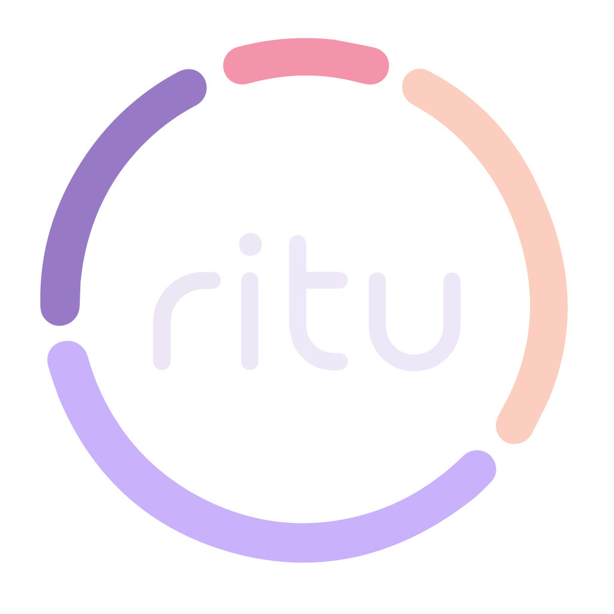

# Ritu — Period Tracker

> ⚠️ **Work in progress.** Ritu is under active development — expect bugs and rough edges. Known gaps right now include daily notes & mood logging, which are broken and being re-added. If you hit something, please file it under [Issues](https://github.com/Rujul-Rumale/Ritu/issues).

**Ritu is a fork of [YIMA](https://github.com/Novawerk/YIMA)** — the privacy-first, open-source period tracker by [Novawerk](https://github.com/Novawerk). YIMA tracks one person. **Ritu tracks the people you care for**: keep a private cycle history for yourself, a partner, family, and friends — all in one app, all on your device.

Built with Kotlin Multiplatform and Compose Multiplatform. No account, no cloud, no network, no analytics, no ads.

**Maintained by [Rujul](https://github.com/Rujul-Rumale)** · upstream project by [Novawerk](https://github.com/Novawerk).

## A fork of YIMA

This project would not exist without YIMA (姨妈来了), the MIT-licensed, local-only menstrual cycle tracker created by Novawerk. Ritu keeps YIMA's foundation — the prediction engine, the Material 3 Expressive interface, health-data sync, and the privacy-first architecture — and builds on top of it.

**What Ritu adds to YIMA:**

- **Multi-person tracking** — manage several people in one app. Each person has their own cycle settings, records, daily logs, and predictions. The home screen shows one person at a time with a picker to switch.
- **"For me / For someone else" onboarding** — set up your own cycle, or start tracking for someone else right away.
- **Per-person reminders** — period, ovulation, and daily notifications are scheduled separately for each person.

Everything else — the cycle math, phases, calendar, health sync, report export, localization — is inherited from YIMA and credited to its authors (see [Credits](#credits)).

## Why Ritu exists

Most small utility apps used to be good. Somewhere along the way, the pressure to monetize turned them into something else — core features hidden behind paywalls, interfaces bloated with ads and upsells, settings pages that quietly exist to nudge you toward a subscription. The experience gets cut down until what's left barely resembles the tool you originally wanted.

YIMA was a deliberate experiment in the other direction: **design a small tool without profit as a constraint, and see whether the experience can become good again**. Ritu inherits that philosophy — no business model, no ads, no account, no data harvesting — and extends it to the people around you. A cycle tracker is more useful when it can hold the whole household, not just one person.

## Features

### Multi-person tracking (Ritu)
- **Several people, one app** — each person keeps a fully separate cycle: their own period length, cycle length, records, daily logs, and predictions
- **"This is me" flag** — mark your own profile so the app can label it and remember which person is you
- **Person switcher** — move between people from the home screen; the calendar, statistics, and reminders all follow the selected person

### Logging
- **One-tap period tracking** — "Period arrived" / "Period ended" buttons on the home screen, with an estimated end date based on the person's average period length until you confirm it
- **Backfill past periods** — add any historical period by selecting a range on the calendar
- **In-calendar editing** — tap any day in the detail view to add, delete, extend, or shorten a period directly

### Predictions & cycle phases
- **Next 3 cycles predicted** — based on the person's historical average cycle length, with a fallback to the cycle length set in onboarding
- **Anomaly filter** — cycles shorter than 14 days are treated as anomalies and excluded from the prediction average, so a one-off irregular cycle doesn't skew the forecast
- **Smart auto-confirm** — if a predicted period is 3+ days past its expected end and nothing has been logged, Ritu quietly auto-confirms it so the calendar stays in sync
- **4 cycle phases** — Menstrual, Follicular, Ovulation, Luteal — calculated with the medical count-back method (ovulation at `cycleLength − 14`, 6-day fertile window)
- **Per-day phase info** — tap any day in the detail calendar to see the cycle day, current phase, ovulation peak, and contextual tips

### Home screen — three views
- **Overview** — large circular calendar showing the current cycle at a glance with a phase indicator
- **Detail calendar** — month-by-month swipeable pager with color-coded period days, predicted days, ovulation window, ovulation-peak flower icon, and period start/end markers
- **Statistics** — bar chart of recent cycles (with anomaly highlighting), averages over the last 6 cycles, and a scrollable record history

### Daily logging (per-day bottom sheet)
- **Flow intensity** — Light / Medium / Heavy
- **Mood** — 😊 😐 😔 😢
- **Symptoms** — Cramps, back pain, headache, breast pain, fatigue
- **Free-text notes**

### Notifications (opt-in)
- **Period reminder** — 1–7 days before the next predicted period
- **Ovulation reminder** — 1–7 days before the ovulation peak day
- **Daily reminder** — at a time you choose

All three are off by default and require an explicit OS-level permission grant. Reminders are scheduled **per person**.

### Health data sync
- **Apple Health & Google Health Connect** — bidirectional sync of menstrual period and flow data via [HealthKMP](https://github.com/vitoksmile/HealthKMP)
- **Import** — reads periods from the health platform and merges them with existing records (skips overlapping ranges)
- **Export** — writes manually-logged periods back to the health platform
- **Opt-in** — off by default; enable in Settings under "Health Data"

### Cycle report export
- **Long-image PNG report** — generates a single shareable image containing a summary (total records, average cycle, average period) and every record with its daily logs (flow, mood, symptoms, notes)
- **Pick the report language** — English or Chinese, independent of the app language
- **Native share sheet** — uses the OS share sheet on both Android and iOS, so you can save it, send it to a doctor, or share with whoever you want — Ritu never sees the file

### Onboarding
- "For me / For someone else" — set up your own cycle or add someone else
- Welcome screen with app logo
- Pick the last period range on a calendar
- Set period duration (2–10 days) and cycle length (20–45 days) with sliders
- Ritu auto-generates 5 past cycles using the settings, so predictions and statistics work from day one

### Settings
- Display mode — System / Light / Dark
- Language — Auto / English / 中文
- Period duration & cycle length (sliders, editable any time)
- Health data sync (Apple Health / Google Health Connect)
- Notifications
- Cycle report export
- About (version, author, upstream credit)
- Clear all data (destructive, with confirmation)

### Privacy
- **Local-only storage** — everything is stored in Jetpack DataStore on your device
- **No account, no sign-in, no phone number**
- **No network calls for user data** — the standard build makes no HTTP requests carrying cycle information
- **No analytics, no trackers, no ads**
- **Open source** — audit the code yourself
- **Disclaimer on first launch** — Ritu is a tracking tool, not a medical device

### Platform & design
- **Android** (min SDK 26) and **iOS** — shared codebase
- **Material Design 3 Expressive** with custom Comfortaa typography
- English localization with localized month and weekday names

## Screenshots

| Overview | Detail calendar | Statistics | Reminders | Settings |
|---|---|---|---|---|
| 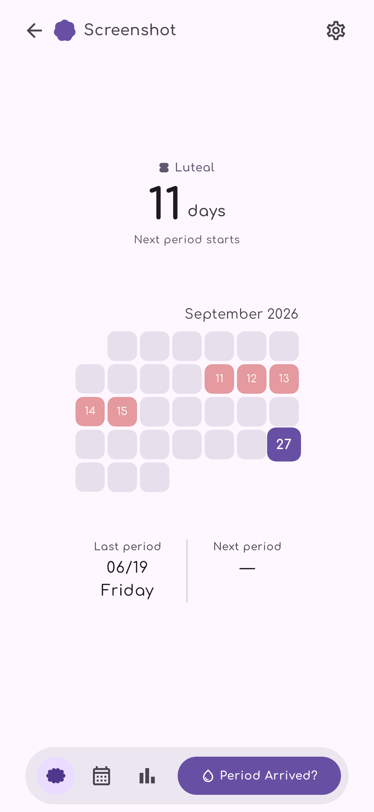 | 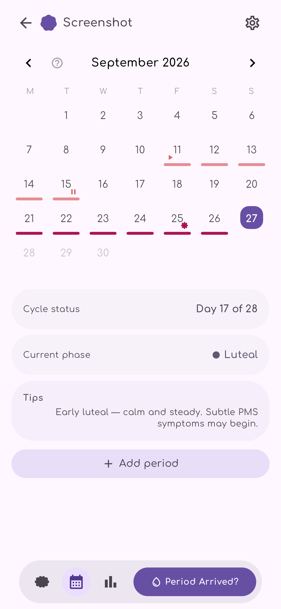 | 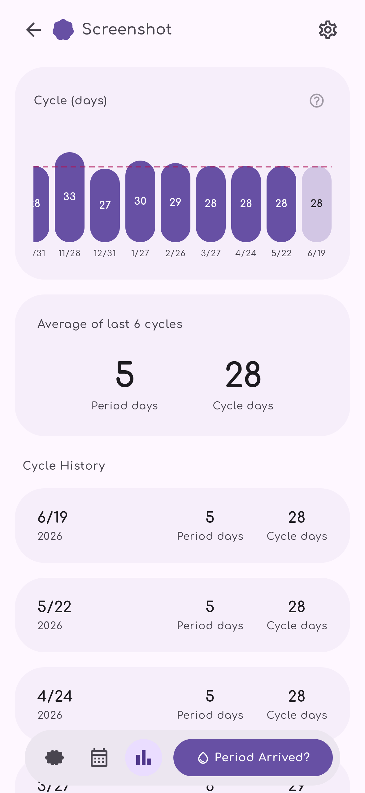 | 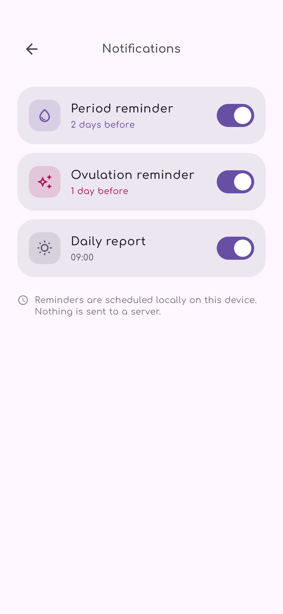 | 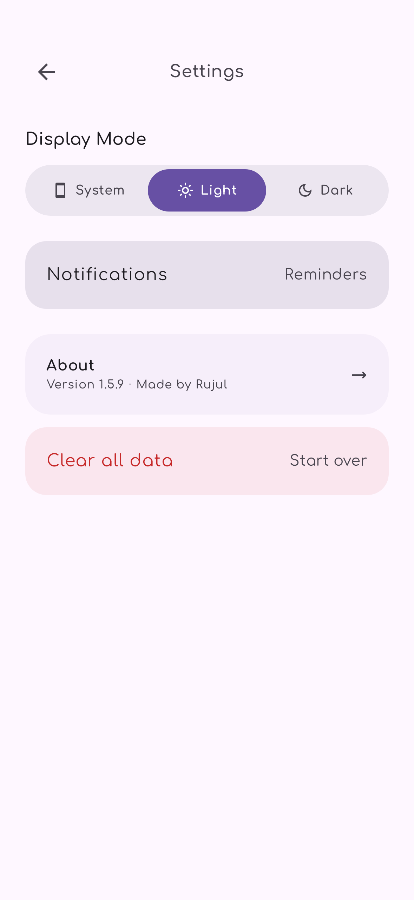 |
| 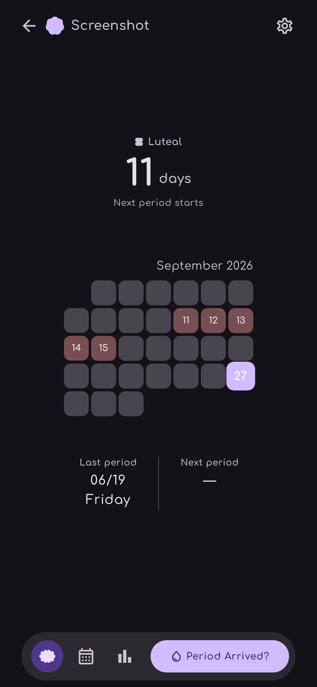 | 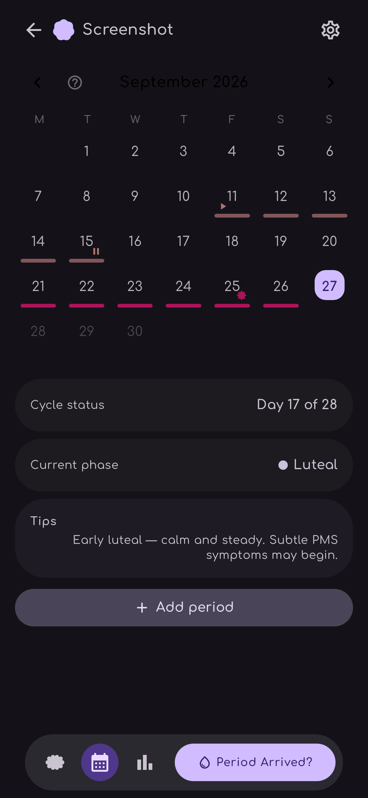 | 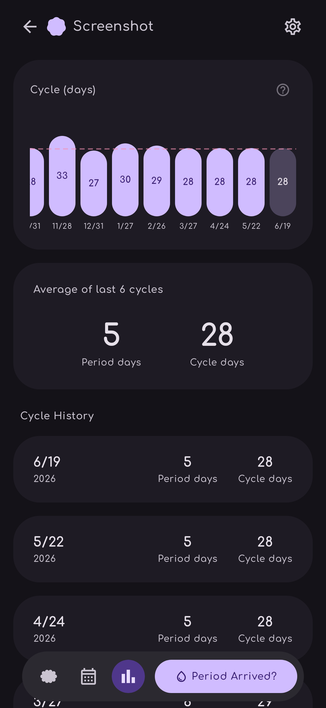 | 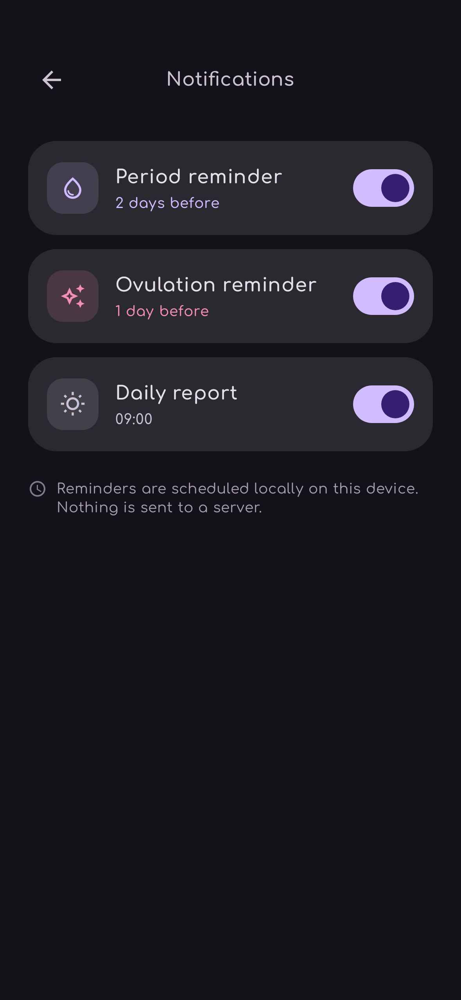 | 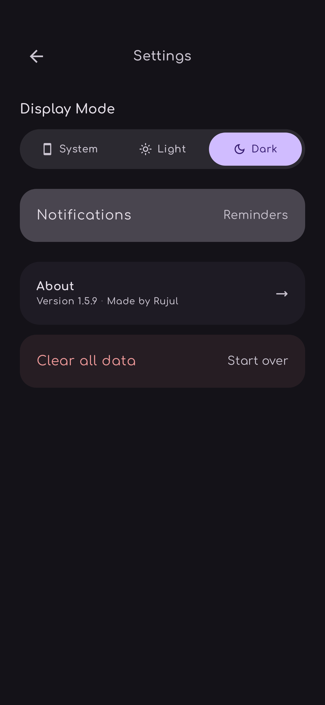 |

_Android, English locale._

### Multi-person tracking

| People list | Person detail | Add person | Purpose |
|---|---|---|---|
| 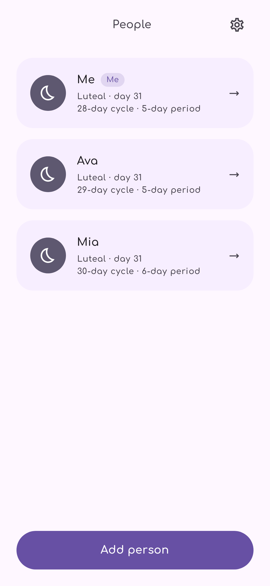 |  | 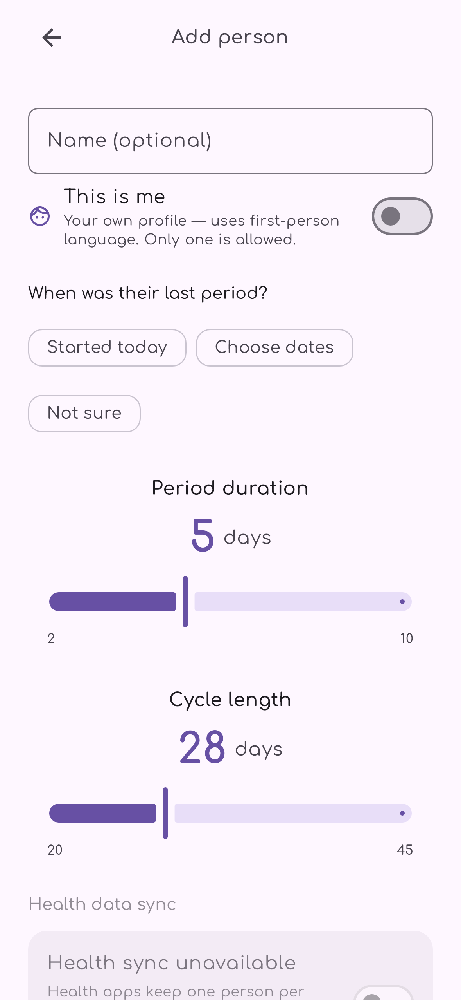 | 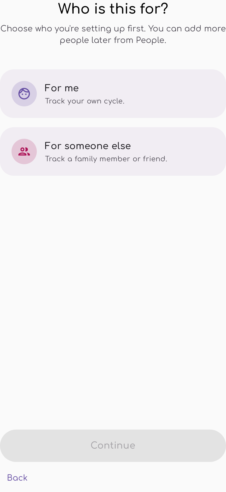 |
| 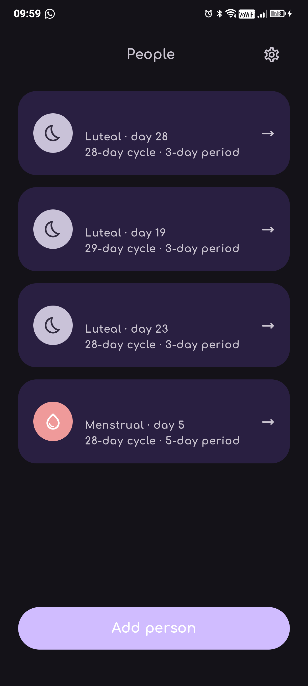 | 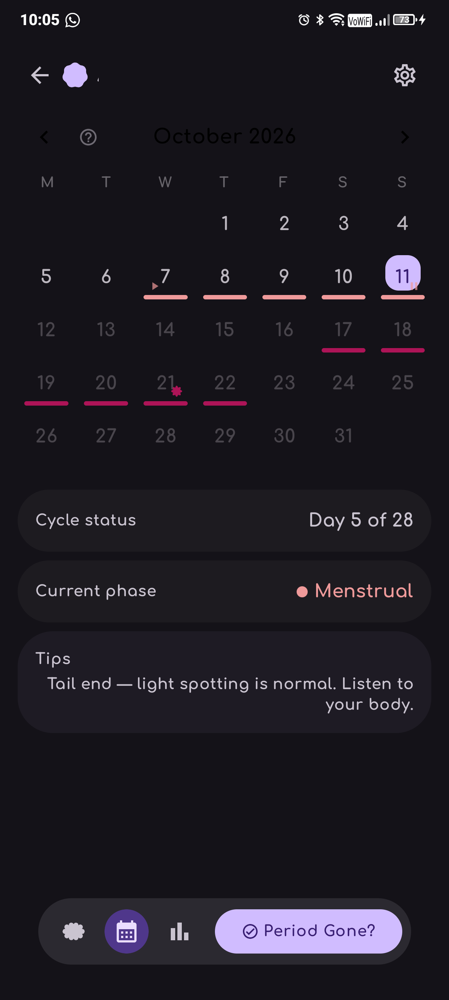 | 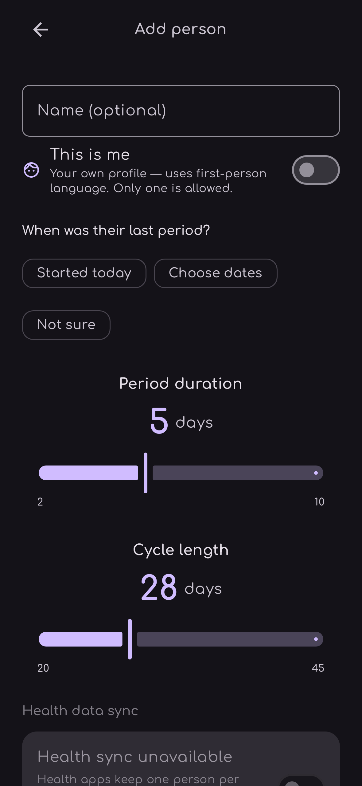 | 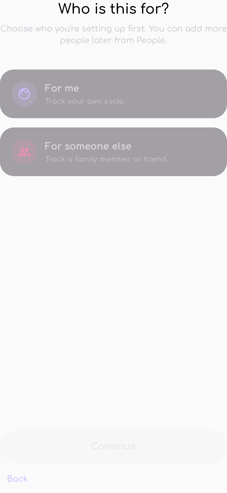 |

_Light shots use test data. Dark People/Detail shots are from a real device with names redacted._

## Tech Stack

| Layer | Technology |
|-------|-----------|
| Language | Kotlin 2.3 |
| UI | Compose Multiplatform 1.11 (Material 3 Expressive) |
| Navigation | Compose Navigation with type-safe `@Serializable` routes |
| DI | kotlin-inject + KSP (`@KmpComponentCreate`) |
| Health | [HealthKMP](https://github.com/vitoksmile/HealthKMP) (Apple HealthKit + Google Health Connect) |
| Storage | Jetpack DataStore Preferences + kotlinx.serialization |
| Date/Time | kotlinx-datetime + kotlinx-datetime-names |
| Notifications | Platform-specific schedulers via `expect` / `actual` |
| Targets | Android (min SDK 26, compile/target 36), iOS |
| Build | Gradle 8.14 with version catalog |

## Architecture

Single module (`:composeApp`) with clean layering. The Kotlin package (`com.haodong.yimalaile`) retains the upstream namespace from YIMA:

```
composeApp/src/commonMain/kotlin/com/haodong/yimalaile/
├── App.kt                            # Root composable + NavHost
├── di/                               # kotlin-inject root component
├── domain/
│   ├── menstrual/                    # MenstrualService, cycle logic, models
│   ├── health/                       # HealthService, HealthSyncManager
│   ├── notifications/                # Reminder scheduling contracts
│   └── settings/                     # SettingsRepository + AppDarkMode
├── infrastructure/
│   └── persistence/                  # DataStore-backed repository implementations
└── ui/
    ├── theme/                        # M3 Expressive theme + Comfortaa font
    ├── navigation/                   # Type-safe routes
    ├── components/                   # Shared calendar & layout composables
    └── pages/
        ├── disclaimer/               # First-launch medical disclaimer
        ├── onboarding/               # Purpose / period / cycle / notifications
        ├── home/                     # Overview / detail / statistics modes
        ├── settings/                 # Settings + notification settings
        └── sheet/                    # Shared bottom-sheet host for logging, details, pickers
```

## Building

```bash
# Prerequisites: JDK 17+, Android SDK

# Build the debug APK
./gradlew :composeApp:assembleDebug

# Install on a device / emulator
./gradlew :composeApp:installDebug
```

For iOS, open `iosApp/` in Xcode and build normally. Copy `iosApp/Configuration/Config.xcconfig.template` to `Config.xcconfig` and fill in your Team ID first.

## Business Rules

1. Cannot start a new period while one is already active (no confirmed end date)
2. Period date ranges cannot overlap
3. Backfill is not blocked by an active period
4. Predictions require at least one existing record; onboarding seeds 5 past cycles so the app is immediately useful
5. Cycles shorter than 14 days are treated as anomalies and excluded from the prediction average and the statistics averages
6. Predictions that pass their expected end date by 3+ days are auto-confirmed as real records
7. Ending or shortening a period auto-trims any daily records outside the new range
8. All data is local-only; a disclaimer is shown on first launch
9. Ritu is a tracker, not a medical device — no clinical claims

## Credits

Ritu is built on the work of others:

- **[YIMA](https://github.com/Novawerk/YIMA)** — the upstream project by [Novawerk](https://github.com/Novawerk), MIT-licensed. Ritu is a fork that adds multi-person tracking. The original copyright and license notices are preserved in [LICENSE](LICENSE) and [NOTICE](NOTICE).
- **[HealthKMP](https://github.com/vitoksmile/HealthKMP)** by Vitoksmile — Apple HealthKit and Google Health Connect integration.
- **Comfortaa** typeface, used under the SIL Open Font License.

## License

Ritu is released under the [MIT License](LICENSE) — the same license as its upstream base.

- Copyright (c) 2025–2026 [Novawerk](https://github.com/Novawerk) — original YIMA project
- Copyright (c) 2026 [Rujul](https://github.com/Rujul-Rumale) — Ritu fork

You are free to use, modify, and distribute this software, as long as the original copyright notice is included.
